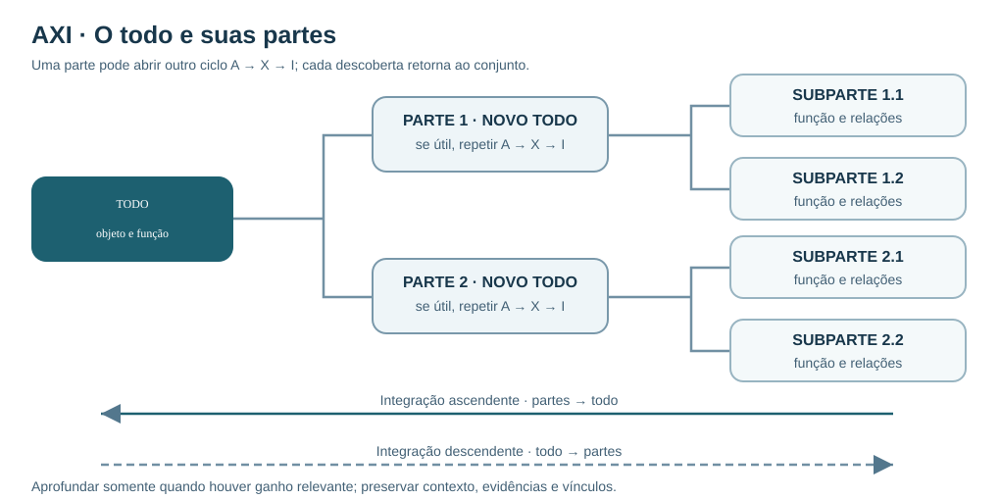

# AXI Pesquisa

**Versão 2.4.1 · software experimental; validação científica independente pendente.**

**Análise · eXpansão · Integração** — método autoral de Wilker M. de Araujo Alexandre para organizar explicações, comparações e relações práticas com apoio de inteligência artificial.

> **Projeto experimental e pesquisa em andamento.** O método completo ainda não possui eficácia científica demonstrada. O repositório reúne instaladores, código, histórico e documentação de avaliação.

**Acesso rápido:** [Baixar instaladores](#baixar-a-skill-axi) · [Todas as versões e situação dos downloads](docs/INSTALADORES.md) · [Pesquisa científica](docs/PESQUISA-CIENTIFICA.md) · [Histórico e rastreabilidade](INDICE-ORIGEM.md)

## Princípio central — investigação recursiva do todo e das partes

**Cada parte pode abrir uma nova investigação, mas toda descoberta precisa retornar à estrutura maior para adquirir significado.** O resultado reintegrado ao todo também deve atualizar as partes relacionadas. A lista encadeada é uma analogia da progressão; a estrutura do conhecimento é **recursiva e relacional**, com hierarquias e vínculos cruzados.

| Fase | Movimento | Pergunta |
|---|---|---|
| **A — Análise** | 1. Identificar o todo | O que investigamos? |
| **A — Análise** | 2. Identificar as partes | Quais são seus componentes relevantes? |
| **A — Análise** | 3. Identificar a função do todo | O que faz e para quê? |
| **A — Análise** | 4. Identificar a função de cada parte | Como cada componente contribui? |
| **X — eXpansão** | 5. Expandir o todo | Quais contextos, relações e analogias ajudam? |
| **X — eXpansão** | 6. Expandir cada parte | Qual parte justifica um novo ciclo A → X → I? |
| **I — Integração** | 7. Integrar o todo | Como os achados das partes recompõem o conjunto? |
| **I — Integração** | 8. Integrar cada parte | Como a visão atualizada do todo muda as partes? |

**Integração bidirecional:** ascendente (**partes → todo**) e descendente (**todo → partes**). Cada parte relevante pode tornar-se **novo todo** e repetir o ciclo A → X → I, preservando referências ao todo-pai, fontes, funções e relações. Parar quando o aprofundamento não trouxer ganho relevante; não inventar decomposição ou vínculos.

**Padrão visual da AXI v2.4.0 preservado:** a imagem nesta página é um SVG equivalente a uma árvore da esquerda para a direita em cartões; não afirma suporte nativo a Markmap no GitHub. Na Skill, priorizar Markmap Tree + Cards na fase A quando houver hierarquia fiel e renderer disponível; na fase I, preservar a exigência independente de diagrama visual de fluxo real.

## Baixar a Skill AXI

**v2.4.1 — recursividade do todo e das partes, preservando Markmap Tree + Cards da v2.4.0 na fase A e Mermaid/IMAGEM OBRIGATÓRIA na fase I.** Na **fase A**, priorizar **Markmap** (`layout: tree`, `theme: cards`, leitura esquerda→direita) efetivamente renderizado e visível ou figura equivalente (`SVG`/`PNG`/visual nativo); sem recurso visual viável, declarar **`ENTREGA PARCIAL — MAPA VISUAL NÃO EXIBIDO`**. Na **fase I**, a imagem do fluxograma deve aparecer **na própria resposta ou em prévia gráfica aberta**; tabela, ASCII, lista, código Mermaid/SVG/HTML e arquivo não mostrado são **entrega parcial**, não resultado concluído. A regra aplica-se às oito plataformas, sem inventar árvores ou fluxos nem quebrar formatos estritos.

**Gemini:** primeiro pedir/acionar **geração direta de imagem (SVG efetivamente renderizado ou PNG exibido)** (ou Markmap na fase A se realmente suportado na sessão), sem pedir HTML, aplicativo ou interatividade por padrão. Canvas/SVG é apenas alternativa quando criar realmente uma figura visível; a documentação do Google ainda restringe Canvas com Skills. **ChatGPT:** Mermaid com prévia desenhada na I e Markmap/equivalente em prévia na A quando disponível. **Claude:** visual HTML/SVG inline ou Artifact visível. **Grok:** SVG/PNG com prévia inline ou imagem visível no Projects. **PDF e downloads não são obrigatórios**; a figura visual, sim. **Ressalva de homologação:** os testes da v2.4.0 foram estruturais (`124/124 PASS`); a v2.4.1 requer validação própria e homologação funcional nas interfaces externas.
**Toda resposta explicativa ou de pesquisa deve ter `Fontes consultadas (ABNT)`**, registrando as fontes efetivamente consultadas ou `Nenhuma fonte externa consultada nesta resposta.`. **A leitura integral dos materiais da Skill, arquivo por arquivo e na sequência A → X → I, é obrigatória quando ativada.** Em temas legais e administrativos específicos, é obrigatório consultar fontes normativas verificáveis quando houver acesso e apresentar referências ABNT reais. Lei, artigo, competência e procedimento não podem ser presumidos nem afirmados obrigatórios sem fonte; o diagrama não substitui a pesquisa.

**Referência técnica de engenharia:** o projeto adota **Semantic Versioning (SemVer 2.0.0)** para rastreabilidade e compatibilidade; isso **não comprova eficácia científica** do AXI. Veja [Fundamentação técnica](docs/FUNDAMENTACAO-TECNICA.md) e [Notas da v2.4.1](docs/RELEASE-v2.4.1.md) e [baseline visual v2.4.0](docs/RELEASE-v2.4.0.md). As [v2.3.8](https://github.com/wilkermaa/axipesquisa/releases/tag/v2.3.8), [v2.3.7](https://github.com/wilkermaa/axipesquisa/releases/tag/v2.3.7), [v2.3.6](https://github.com/wilkermaa/axipesquisa/releases/tag/v2.3.6), [v2.3.5](https://github.com/wilkermaa/axipesquisa/releases/tag/v2.3.5), [v2.3.4](https://github.com/wilkermaa/axipesquisa/releases/tag/v2.3.4), [v2.3.3](https://github.com/wilkermaa/axipesquisa/releases/tag/v2.3.3), [v2.3.2](https://github.com/wilkermaa/axipesquisa/releases/tag/v2.3.2) e [v2.3.1](https://github.com/wilkermaa/axipesquisa/releases/tag/v2.3.1) permanecem preservadas. A homologação real nas interfaces continua pendente.

| Plataforma | Instalador v2.4.1 |
|---|---|
| ChatGPT Web | [Baixar ZIP](https://github.com/wilkermaa/axipesquisa/releases/download/v2.4.1/01-CHATGPT-WEB-AXI-v2.4.1.zip) |
| Gemini Web | [Baixar ZIP](https://github.com/wilkermaa/axipesquisa/releases/download/v2.4.1/02-GEMINI-WEB-AXI-v2.4.1.zip) |
| Claude Web | [Baixar ZIP](https://github.com/wilkermaa/axipesquisa/releases/download/v2.4.1/03-CLAUDE-WEB-AXI-v2.4.1.zip) |
| Grok Web | [Baixar ZIP](https://github.com/wilkermaa/axipesquisa/releases/download/v2.4.1/04-GROK-WEB-AXI-v2.4.1.zip) |
| Codex | [Baixar ZIP](https://github.com/wilkermaa/axipesquisa/releases/download/v2.4.1/05-CODEX-AXI-v2.4.1.zip) |
| Claude Code | [Baixar ZIP](https://github.com/wilkermaa/axipesquisa/releases/download/v2.4.1/06-CLAUDE-CODE-AXI-v2.4.1.zip) |
| Antigravity | [Baixar ZIP](https://github.com/wilkermaa/axipesquisa/releases/download/v2.4.1/07-ANTIGRAVITY-AXI-v2.4.1.zip) |
| Grok Build | [Baixar ZIP](https://github.com/wilkermaa/axipesquisa/releases/download/v2.4.1/08-GROK-BUILD-AXI-v2.4.1.zip) |

Os links são destinados aos anexos do Release correspondente. Para instalar, veja [o guia dentro da Skill](skill/axipesquisa/README-INSTALACAO.md). O experimento C0/C1/C2 permanece congelado na v2.2.0-rc2, sem execuções comprovadas.

Para recuperar uma versão anterior, consulte o [catálogo de instaladores e estado de publicação de cada versão](docs/INSTALADORES.md). **Já estão disponíveis downloads por IA para [v2.2.1](https://github.com/wilkermaa/axipesquisa/releases/tag/v2.2.1), [v2.2.0-rc4](https://github.com/wilkermaa/axipesquisa/releases/tag/v2.2.0-rc4), [v2.2.0-rc3](https://github.com/wilkermaa/axipesquisa/releases/tag/v2.2.0-rc3), [v2.2.0-rc2](https://github.com/wilkermaa/axipesquisa/releases/tag/v2.2.0-rc2) e [v2.0.0 sanitizada](https://github.com/wilkermaa/axipesquisa/releases/tag/v2.0.0).** As versões históricas documentadas vão de v1.0 a v2.2.3; a [v2.3.0 tem oito instaladores publicados](https://github.com/wilkermaa/axipesquisa/releases/tag/v2.3.0). As versões v1.0 e v2.1.0-rc1 permanecem registros documentais parciais, sem instaladores completos identificados no respectivo snapshot. A área de [GitHub Releases](https://github.com/wilkermaa/axipesquisa/releases) é o destino previsto para futuras distribuições versionadas com assets e tags próprias.

Veja a [matriz de renderização v2.3.0](docs/DECISAO-RENDERIZACAO-v2.3.0.md) para o reconhecimento de capacidades e os testes de aceite da fase I.

## O que é o AXI?

| Etapa | Pergunta central | Resultado pretendido |
|---|---|---|
| **A — Análise** | O que é o todo? Quais são suas partes? | Identificação, decomposição, funções e limites |
| **X — eXpansão** | Com o que podemos comparar essas relações? | Analogias úteis, diferenças e limites da comparação |
| **I — Integração** | Como as partes se articulam e como aplicar isso? | Funcionamento do conjunto, relações e exemplos concretos |

## A pesquisa científica

O projeto investiga **o todo e as partes**, a comparação entre estruturas e a recomposição das relações em explicações mediadas por IA. Os referenciais estudados incluem:

- **René Descartes:** divisão dos problemas, ordenação do simples ao complexo e revisão do raciocínio.
- **AXI, de Wilker M. de Araujo Alexandre:** protocolo autoral A → X → I e suas hipóteses de aplicação.
- **Erin Meyer:** influência dos contextos culturais sobre comunicação e interpretação, sem presumir características individuais.
- **Robert B. Dilts:** níveis de contexto, comportamento e propósito como referência conceitual, sem alegação de validação científica da PNL ou do AXI.

**Leia o [programa científico, hipóteses, metodologia e fontes em ABNT](docs/PESQUISA-CIENTIFICA.md).** O projeto também preserva a [fundamentação científica anterior](versoes/v2.1.0-rc1/AXI-Pesquisa-v2.1.0-rc1-FUNDAMENTACAO.md).

O desenho experimental anterior prevê comparar respostas sem AXI, com instruções genéricas e com AXI. **Não há conclusão de superioridade antecipada.** A condição experimental v2.2.0-rc2 permanece congelada para preservar comparabilidade. A publicação da Skill não significa validação científica.

## Código, histórico e direitos

- [Tags históricas](https://github.com/wilkermaa/axipesquisa/tags), [Releases](https://github.com/wilkermaa/axipesquisa/releases) e [índice de origem](INDICE-ORIGEM.md).
- [Política visual da Skill](docs/POLITICA-VISUAL.md), [política organizacional](POLITICA-ORGANIZACIONAL.md) e [auditoria das tags](docs/AUDITORIA-TAGS.md).
- [README anterior, preservado como acervo](docs/ACERVO-HISTORICO.md).
- Consultar arquivos de licença e atribuição aplicáveis a cada versão. As licenças de código e texto não substituem os direitos de terceiros.

---

◌ AXI · Wilker M. de Araujo Alexandre
