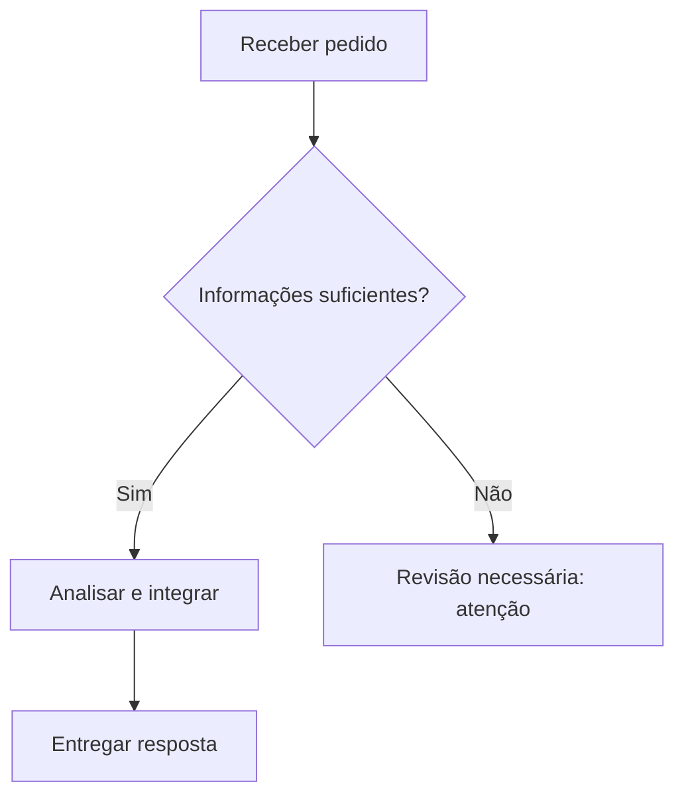

# Recomendações editoriais, culturais e visuais

## Dilts: inspiração heurística, não eficácia científica

Use as perguntas `onde/quando?`, `o quê?`, `como?`, `com quais critérios?`, `quem tem qual papel?`, `para quê?` como **checklist editorial facultativo** para esclarecer uma explicação. São adaptadas do discurso dos níveis lógicos de Robert Dilts; não implicam que o modelo da PNL seja um mecanismo cerebral estabelecido, instrumento terapêutico, técnica de persuasão cientificamente comprovada ou ferramenta para inferir identidade do leitor.

## Meyer: preferências comunicativas, não tipos culturais

O livro *The Culture Map* oferece oito dimensões da comunicação e colaboração intercultural. Para elaboração de conteúdos, traduzir **preferências explicitadas pelo usuário** em decisões de projeto: argumentos por princípios ou exemplos, crítica direta ou contextualizada, grau de explicitação, distribuição de decisões e confiança documentada. **Nunca** atribuir comportamento a um indivíduo pela nacionalidade, língua, religião, etnia ou profissão; escalas de grupos não são diagnósticos pessoais.

## Sweller e Mayer: forma como hipótese didática contextual

- Segmentar informações complexas em porções utilizáveis, sinalizar relações importantes e eliminar decoração que concorra com conteúdo.
- Diagramas: A = estrutura/partes; X = matriz de correspondências; I = fluxo ou rede de interações. Só apresentar visual se ele representar informação que texto isolado explicaria pior.
- Preferir tabelas apenas para critérios comparáveis. Não converter números em gráficos sem dados, nem usar cores como única codificação.
- Usar texto alternativo, títulos claros, hierarquia visual e acessibilidade.
- Não deduzir estilos fixos visual/auditivo/cinestésico; não afirmar que um diagrama melhora toda aprendizagem em todo público.

## Diagramas na fase I: Mermaid, renderização real e exportação

**Dois cenários distintos**

1. **Diagrama não solicitado:** escolha visualização apenas quando aumentar a compreensão. Não substitua uma resposta breve por um esquema decorativo.
2. **Diagrama solicitado explicitamente:** o resultado esperado é um gráfico visual real, quando as ferramentas habilitadas permitirem. Um bloco `mermaid` não é, por si só, prova de que o gráfico foi renderizado. Wireframes representam telas; não substituem diagrama de arquitetura, fluxo, decisões ou relações.

**Procedimento objetivo para pedido explícito:**

1. Inspecione os recursos *efetivamente disponíveis na sessão*. Tente o renderer Mermaid nativo, se houver. Caso não esteja disponível, considere Canvas/artefatos ou uma ferramenta habilitada que produza SVG e PNG. Não suponha que a indisponibilidade de um parser Mermaid signifique impossibilidade de gerar qualquer diagrama visual.
2. Faça uma tentativa concreta, respeitando as ferramentas permitidas. Preserve nós, arestas, condições, ordem e subgrafos. Não crie relações ausentes.
3. Se a saída não tiver sido produzida com motor Mermaid, apresente-a como **conversão ou reconstrução visual equivalente**, não como Mermaid compilado. Preserve a fonte `.mmd` quando possível.
4. Quando houver arquivos produzidos e verificados, ofereça **SVG e PNG para download**. Nunca crie links imaginários; não prometa um arquivo que não foi salvo.
5. Se a visualização/exportação for indisponível ou falhar, descreva especificamente a ferramenta ausente ou a tentativa fracassada e entregue o código Mermaid válido. Não dê uma afirmação genérica de que a plataforma não suporta gráficos.

## Gemini Web: fallback visual verificável sem Mermaid nativo

**Não confundir:** um bloco `mermaid` com destaque de sintaxe não é um gráfico visível. Se o usuário solicitou expressamente um diagrama, use o seguinte fluxo, limitado às ferramentas realmente disponíveis:

1. **Mermaid renderizado**: se existir visualizador nativo nesta sessão, produza o bloco Mermaid e confirme a possibilidade de prévia; não alegue que o usuário o viu se não houver confirmação do frontend.
2. **SVG autônomo**: se não houver renderer Mermaid, desenhe um **SVG correto** com `<svg xmlns="http://www.w3.org/2000/svg" viewBox="...">`, grupos, retângulos, caminhos, setas, rótulos e, quando pertinente, descrições `<title>` e `<desc>`. Preserve grafo, arestas, ordens e decisões. Não converter labels não confirmados em fatos; usar neutro e `a validar`. Se o Gemini oferecer criação de arquivos, salve `diagrama.svg` e disponibilize link real.
3. **Gemini Canvas com HTML/SVG**: quando Canvas estiver disponível, solicite ou crie um app/página HTML com SVG inline. Visualização na **prévia do Canvas** é diferente do mero código no chat. Se a ferramenta suportar execução do código, forneça botão `Salvar SVG` (Blob XML) e `Salvar PNG` (serialização SVG em imagem, desenho no `<canvas>`, `toBlob`). Só atribua sucesso à exportação após ela estar disponível e ter sido verificada. Não injete scripts externos, não use CDNs para dados confidenciais nem crie rótulos fictícios.
4. **Alternativa quando o Canvas não abrir pela Skill**: informe ao usuário que, em Gemini Web, ele pode selecionar **Adicionar arquivos (+) → Canvas**, e então colar o HTML/SVG autossuficiente. Não declare que a interface está aberta sem evidência. Se houver capacidade de criar arquivo SVG/PNG diretamente na tarefa, prefira esses arquivos reais.
5. **Fallback final**: se nenhuma forma de renderização/exportação existir, forneça o código SVG e Mermaid completos, com instrução curta de visualização no navegador ou Canvas, explicando a limitação comprovada. Não diga genericamente que a plataforma não gera SVG/PNG.

**Formato de retorno para pedido de gráfico:** liste com precisão `Diagrama visível?`, `SVG para download?`, `PNG para download?`, `Código Mermaid?` marcando `sim`, `não`, ou `precisa de ação do usuário` apenas após evidência. Um SVG textual pode ser uma fonte válida, mas não se deve confundir texto SVG com prévia renderizada.

**Segurança e simplicidade:** toda conversão deve ser local/nativa quando possível; jamais envie arquiteturas internas, tokens ou dados pessoais a serviços externos de renderização sem permissão; código executável gerado é sujeito à política de segurança da plataforma. Um wireframe não substitui um diagrama de relações solicitado.

**Cuidados visuais:** hierarquia clara, conexões legíveis, poucos cruzamentos, sem exagero de estilos. Verde = concluído, amarelo = atenção, vermelho = bloqueado **apenas para estados sustentados por dados**, sempre com rótulos legíveis. Estados não comprovados devem permanecer **a validar**, em estilo neutro. Cores não substituem texto.

**Privacidade:** não envie diagramas com dados pessoais, fluxos internos, segredos ou informação restrita a renderizadores externos sem autorização explícita. Prefira recursos locais ou do serviço já autorizado. O diagrama não prova causalidade nem eficácia.

**Critério para revisão:** verifique se o usuário consegue **ver o gráfico** e baixar o arquivo nos formatos solicitados, ou recebe relato preciso da limitação efetiva. A mera sintaxe válida não satisfaz pedido de gráfico visual.

**Exemplo Mermaid ilustrativo (não representa estados reais):**

Não reproduza automaticamente este exemplo na resposta: crie um gráfico ajustado às relações confirmadas do caso.

## Saída adaptativa

Uma pessoa pode preferir resposta em uma linha, três parágrafos ou relatório completo. O AXI pode operar internamente sem forçar cabeçalhos. Quando houver exigência de saída rígida, preservar o artefato, colocando documentação externa apenas se houver canal apropriado.
